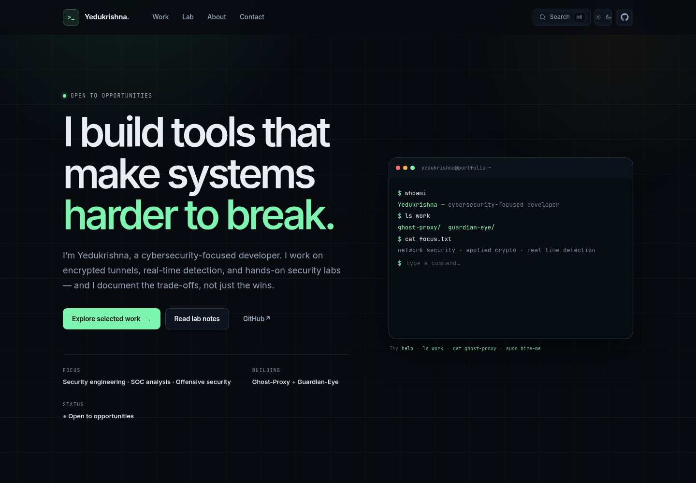

# Yedukrishna — security portfolio

A fast, static portfolio for security engineering, applied cryptography, real-time detection, and hands-on lab work. Built with Astro, TypeScript, and vanilla JavaScript; deployed to GitHub Pages; and kept current by a review-first GitHub project sync.

[Live site](https://yedu1337.github.io) · [Profile README](profile-readme/README.md) · [Security policy](SECURITY.md)



## What is here

- A responsive, accessible portfolio with dark and light themes.
- An interactive terminal on the home page (`help`, `ls work`, `cat ghost-proxy`, `nmap`, `sudo hire-me`).
- A `⌘K` / `Ctrl+K` command palette for pages, projects, email, and theme.
- Long-form case studies for **Ghost-Proxy** and **Guardian-Eye**.
- Reproducible lab notes for Metasploitable 2, Nmap, Wireshark, and Linux/scripting foundations.
- A scoring-based project sync that opens a pull request when it finds a new public repository worth showing.
- A generated GitHub profile README from the same project data.
- Static output, no trackers, no cookies, and a published `security.txt`.

## Stack

- **Astro 7** with static output
- **TypeScript 6** and strict checks
- Vanilla JavaScript islands for the terminal and command palette
- **Octokit** for GitHub discovery
- GitHub Actions for CI, Pages deployment, project sync, profile sync, and CodeQL
- Dependabot for npm and Actions updates

## Local development

Node 24 or newer is recommended (Astro requires at least 22.23.4).

```bash
npm install
npm run dev
```

Open the URL printed by Astro. To preview a production build:

```bash
npm run build
npm run preview
```

## Scripts

| Command | What it does |
| --- | --- |
| `npm run dev` | Start the Astro dev server |
| `npm run check` | Run Astro and TypeScript diagnostics |
| `npm test` | Run the Node test suite |
| `npm run build` | Build the static site into `dist/` |
| `npm run preview` | Preview the production build |
| `npm run sync` | Discover repositories and update project data |
| `npm run sync:dry` | Score repositories and print a report without writing |
| `npm run profile` | Render `profile-readme/README.md` |
| `npm run profile:check` | Fail if the profile README is stale |

For a local sync, export a token first:

```bash
GH_TOKEN="$(gh auth token)" npm run sync:dry
GH_TOKEN="$(gh auth token)" npm run sync
```

The script needs a token to read pinned repositories and stay inside GitHub's API rate limits. It never writes to GitHub itself.

## Automatic project discovery

`scripts/sync-projects.mjs` reads public repositories for the handle in `site.config.json`, scores each one, and writes:

- `src/data/projects.json` — the projects rendered on the site
- `src/data/sync-report.json` and `.md` — a review artifact

The GitHub Action runs weekly and opens a pull request against `automation/project-sync`. Nothing is published until that pull request is reviewed and merged.

### What gets considered

The score is intentionally based on evidence of a usable project, not stars alone:

- pinned repository or `portfolio-featured` topic
- description, README depth, usage instructions, topics, license, homepage
- CI workflow, tests, releases, and a security policy
- security-relevant topics and documentation
- recent activity, with a small bonus for stars and forks
- penalties for missing descriptions, empty READMEs, tiny repositories, and exercise names

A repository is included as **featured** at a score of roughly 60+, and as a **lab** at roughly 30+. Pinned repositories and explicit topics bypass the threshold. Forks, archived repositories, empty repositories, private repositories, the profile repository, and the portfolio repository itself are excluded.

### Topics

| Topic | Effect |
| --- | --- |
| `portfolio-featured` | Force the repository into featured work |
| `portfolio-lab` | Force the repository into the lab/repository list |
| `portfolio-hide` | Exclude the repository |

GitHub's API can read pinned repositories but cannot set them, so pinning remains a manual choice on your profile.

### Manual overrides

Edit `src/data/overrides.json` to control copy, ordering, or classification:

```json
{
  "My-Project": {
    "category": "lab",
    "order": 7,
    "slug": "my-project",
    "tagline": "A short, specific line for the card.",
    "description": "A longer paragraph used on the work or lab index.",
    "languageLabel": "Go / Python",
    "caseStudy": "/work/my-project/",
    "highlights": ["One concrete detail", "Another concrete detail"],
    "hidden": false
  }
}
```

Useful keys: `hidden`, `category`, `featured`, `order`, `slug`, `name`, `tagline`, `description`, `languageLabel`, `topics`, `highlights`, `caseStudy`, and `cover`.

Existing curated copy, slugs, highlights, and case-study links are preserved when the sync refreshes a project. New projects get a generated tagline and description, which is exactly what the review pull request is for.

### Review flow

1. The scheduled workflow scores new public repositories.
2. If the data changed, it runs checks, tests, and a build, then opens or updates a pull request.
3. Review the project table in the PR body, edit overrides if the generated copy is not right, and merge.
4. Merging to `main` triggers the Pages deployment.
5. The profile README workflow publishes the updated README if `PROFILE_TOKEN` is configured.

If you set an optional `SYNC_TOKEN` repository secret, use a fine-grained token with contents and pull-request write access to this repository. This matters because pull requests created with the default `GITHUB_TOKEN` do not trigger other workflows. The sync workflow runs its own checks before opening the PR, so the branch is still validated without a PAT.

## GitHub Pages deployment

1. Create a public repository named `<username>.github.io`.
2. Push this project to its `main` branch.
3. In **Settings → Pages**, set **Source** to **GitHub Actions**.
4. Let the **Deploy to GitHub Pages** workflow run.
5. Optionally add a custom domain and enable HTTPS in the same settings screen.

The site is a user site, so it lives at the domain root and does not need an Astro `base` path. `site.config.json` is the source of truth for the canonical URL, name, handle, email, and social links.

## Renaming the GitHub account

The current configuration uses `yedu1337`. If you move to a shorter handle, update these before the first deploy:

- `site.config.json`: `handle`, `siteUrl`, and `githubUrl`
- `public/robots.txt`: the sitemap URL
- `public/.well-known/security.txt`: `Canonical` and `Policy`
- `public/og.svg`: the terminal label, if desired; regenerate `public/og.png` afterward
- repository name and GitHub Pages settings
- the profile repository and `PROFILE_REPO` variable, if used

Then run:

```bash
GH_TOKEN="$(gh auth token)" npm run sync
npm run profile
npm run check
npm test
npm run build
```

The sync updates every repository URL from the configured handle.

## Profile README

The profile README is generated from the same data as the site:

```bash
npm run profile
```

The optional **Sync profile README** workflow publishes `profile-readme/README.md` to a public repository named `<username>/<username>`. To enable it:

1. Create the profile repository.
2. Create a fine-grained personal access token with **Contents: Read and write** on that repository.
3. Add it as the `PROFILE_TOKEN` repository secret in this repository.
4. If the profile repository has a different name, add a repository variable `PROFILE_REPO` with that name.

Without the secret, the workflow skips cleanly. The site remains the primary source of truth.

## Security posture

- Static output: no server, database, login, or user-generated content.
- No analytics, advertising pixels, third-party fonts, or cookies.
- GitHub Actions use scoped permissions and commit-pinned action SHAs.
- CodeQL and Dependabot are configured.
- Project changes require review before they reach `main`.
- A machine-readable policy is published at `/.well-known/security.txt`.

Report a vulnerability privately to **yedukrishna012@gmail.com**. See [SECURITY.md](SECURITY.md) for scope and safe-harbor details.

## Content and reuse

This is a personal portfolio. The code is shared so the structure and techniques can be learned from; the identity, writing, diagrams, and project descriptions are not intended for reuse as someone else's portfolio.
